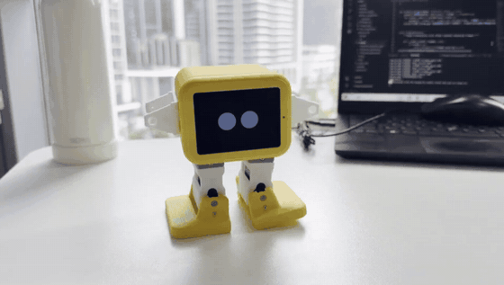
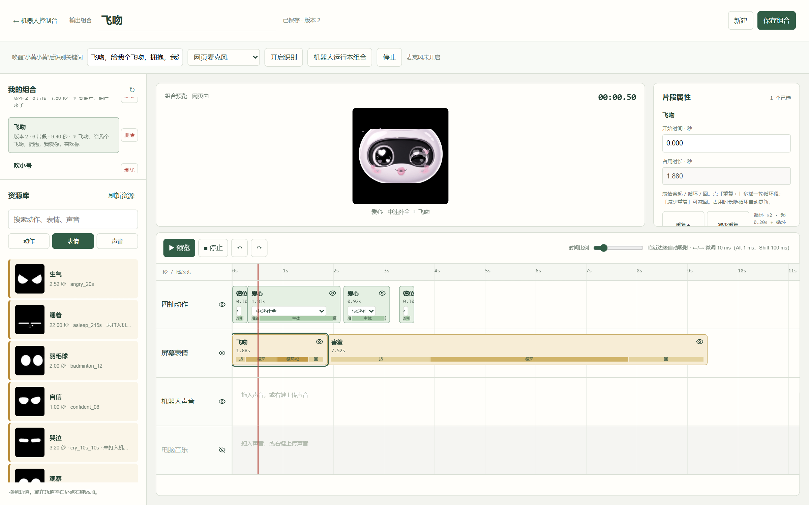

# Otto Robot Platform

## 下载后直接运行

**[下载完整 Windows 运行包](https://github.com/Koko08071/AI_otto_Robot/releases/download/v2026.10.12/Otto-Robot-Windows-v2026.10.12.zip)** · **[全部发布附件](https://github.com/Koko08071/AI_otto_Robot/releases/tag/v2026.10.12)**

完整包适用于 Windows 10/11 Intel/AMD 64 位电脑，内置 Python、依赖、手势模型、离线语音模型、音频、动作、表情素材和公开刷机文件。**完整解压 → 双击 START.bat → 选择蓝牙或填写自己的机器人 Wi-Fi 地址 → 连接控制。** 不用安装 VS Code、Python 或开发环境。先看 [图文快速指南](QUICKSTART.html) 或 [交接说明](HANDOFF.md)。

如果点的是 GitHub 的 **Code → Download ZIP**，得到的是源码包：双击 `START.bat` 会在首次运行时从本项目 Releases 下载并校验运行环境与模型，之后可离线启动。首次下载需要能访问 GitHub，并预留至少 6 GB 空间。想避免首次下载，请直接用上面的完整运行包。

模型和运行环境作为 Releases 附件存储，音频及较小刷机文件随源码提供；没有使用 Git LFS。机器人仍需供电、兼容固件和可用的蓝牙/局域网连接。公开固件没有私人 Wi-Fi 密码；空白主板的使用限制见 [刷机说明](flash/README.md)。

一个面向少儿编程与互动展示的 Otto 人形机器人项目，包含：

- 四舵机动作控制与动作编排
- ST7789 表情屏资源与表情播放
- Wi-Fi / BLE 网页控制台
- 多轨动作、表情、声音编排器
- 笔记本摄像头 YOLO 手势识别
- 语音监听与关键词触发组合动作
- ESP32-S3 固件源码

## 实机效果

下方为真实机器人演示视频的 6 秒节选，点击动图可打开完整视频。

[](docs/media/robot-demo.mp4)

[观看完整演示视频（约 24 秒，含原始音轨）](https://github.com/Koko08071/AI_otto_Robot/raw/refs/heads/main/docs/media/robot-demo.mp4)

## 多轨动作编排器

把机器人一次完整的反应拆成四条时间轨道：**四轴动作、屏幕表情、机器人声音、电脑音乐**。创作者可以拖放片段、调整开始时间和持续时长、切换动作节奏，并在网页内预览，再交给机器人执行。

[](docs/media/multitrack-composer.png)

图为本地控制台的真实截图，点击可查看原图。“飞吻”组合包含 6 个片段：身体先后执行不同节奏的爱心动作，屏幕从飞吻切换到害羞，再按各自时间轴完成表达。此组合的声音轨为空，其他组合可加入台词或音乐。

### 产品设计思路

从儿童体验出发，核心问题是：**孩子做了一个手势、说了一句话后，怎样让机器人给出可理解、有情绪、又能由孩子自己设计的回应？**

| 设计切入点 | 当前实现 | 带来的体验与学习机会 |
|---|---|---|
| 一次触发，一段完整回应 | 语音关键词或手势映射到已保存组合，组合中可串联多个动作与表情 | 一句“给我个飞吻”，可以引出爱心动作、飞吻和害羞的连续表达 |
| 身体、表情和声音共同表达 | 多轨时间轴分别管理动作、屏幕、台词和音乐 | 通过先后顺序、重叠和停顿，让相同素材表现出不同的情绪与节奏 |
| 孩子参与创作 | 拖放片段、修改时长、切换动作节奏、调整表情循环并保存组合 | 让孩子经历“设想反应 → 编排 → 观察 → 修改”，接触顺序、并行、事件触发和调试 |
| 识别与执行分工 | 笔记本完成摄像头手势识别与语音处理，机器人通过 Wi-Fi / BLE 接收相应控制指令 | 便于迭代互动玩法，同时复用四舵机和表情屏的硬件能力 |

这个项目探索的是一套**可以编排的机器人表达方式**：孩子既能与机器人互动，也能成为它的动作、表情和回应方式的设计者。上述教育价值是产品设计目标，仍需通过真实儿童使用测试验证。

## 项目结构

**[查看全部目录与文件的中文用途说明](docs/file-index.md)**：逐项覆盖代码、配置、组合 JSON、表情 GIF、关键帧、缩略视频和测试。进入任意子目录，也可在该目录 README 底部查看直属文件说明。

GitHub 文件列表中间显示的是最近一次提交说明，后续修改时会变化；固定用途说明保存在 README 和上述总索引中。

```text
firmware/              ESP32-S3 / ESP-IDF 固件源码
web/                   本地网页控制台、多轨编排器与资源库
gesture_recognition/   摄像头手势识别和手势到动作映射
docs/                  硬件、通信、动作和维护文档
tools/                 模型下载、环境检查、资源迁移和 Windows 语音合成
models/                手势模型目录（完整包内置，源码从 Releases 下载）
voice-model/           离线语音模型（完整包内置，源码从 Releases 下载）
flash/                 公开刷机文件、写入地址与校验清单
expressions/official/  固件构建引用的机身表情分区镜像
.venv/                 本项目 Python 环境（安装生成，不提交）
```

## 按功能找文件

动作和表情集中在 `web/`，手势识别在 `gesture_recognition/`，机器人板端执行代码在 `firmware/`。点击下面的路径即可进入对应文件。

| 要查看或修改的功能 | 文件位置 | 内容 |
|---|---|---|
| 动作库 | [web/static/actions.json](web/static/actions.json) | 前进、后退、跳舞、中弹侧倒等动作，以及角度、幅度、周期、时长 |
| 表情目录 | [web/static/expressions.json](web/static/expressions.json) | 表情名称、ID、时长和预览资源路径 |
| 表情素材 | [web/static/official/](web/static/official/) / [web/static/concepts/](web/static/concepts/) | 表情图片、GIF 和缩略预览；网页素材不等于已烧录到机器人 |
| 网页前端 | [web/static/](web/static/) | 首页 index.html、交互 app.js、样式 styles.css 等 |
| 多轨编排器 | [web/static/composer.js](web/static/composer.js) | 配套 composer.html / composer.css，编排动作、表情和声音 |
| 已保存组合 | [web/library/compositions/](web/library/compositions/) | “爱你”“你是笨蛋”等组合的轨道、片段和触发词；包含保存时的资源快照 |
| 语音控制 | [web/voice_trigger.py](web/voice_trigger.py) | 语音识别、唤醒词和组合触发逻辑 |
| 手势识别 | [gesture_recognition/recognize.py](gesture_recognition/recognize.py) | 摄像头读取、YOLO 识别、类别显示与稳定判定 |
| 手势对应动作 | [gesture_recognition/gesture_actions.json](gesture_recognition/gesture_actions.json) | 配置识别到某个手势后执行哪个动作或组合 |
| 手势指令发送 | [gesture_recognition/motion_bridge.py](gesture_recognition/motion_bridge.py) | 手势别名、冷却、设备核验及动作发送 |
| 网页摄像头接入 | [web/video_input.py](web/video_input.py) | 将浏览器视频帧接入手势识别流程 |
| 网页服务与通信 | [web/server.py](web/server.py) / [web/ble_link.py](web/ble_link.py) | HTTP 服务、机器人指令转发和蓝牙通信 |
| 板端动作执行 | [firmware/main/behavior.cpp](firmware/main/behavior.cpp) / [firmware/main/otto_motion.cpp](firmware/main/otto_motion.cpp) | 动作时序、插值和舵机 PWM 输出 |
| 板端表情显示 | [firmware/main/robot_face.cpp](firmware/main/robot_face.cpp) / [firmware/main/board_display.cpp](firmware/main/board_display.cpp) | 动画播放和屏幕驱动 |
| 使用与维护文档 | [docs/](docs/) | 硬件通信、手势映射、编排器和维护说明 |

修改动作库后，已保存组合中的动作快照不会自动更新；需要在编排器里更新对应片段并重新保存。

## 快速启动网页控制台

收到包含 `runtime/` 的 Windows 便携交接包时，直接解压后双击 `START.bat`，连接步骤见 [同事交接文档](HANDOFF.md)。从 GitHub 下载源码时，使用下面的安装流程。

Windows 需先安装 Python 3.12。在下载的仓库根目录打开 PowerShell：

```powershell
powershell -ExecutionPolicy Bypass -File .\setup.ps1
.\.venv\Scripts\python.exe tools/download_models.py
.\.venv\Scripts\python.exe tools/check_environment.py
powershell -ExecutionPolicy Bypass -File .\start.ps1
```

如果 Python 没有加入 PATH，安装时指定解释器，例如 `powershell -ExecutionPolicy Bypass -File .\setup.ps1 -Python D:\Robot\Python312\python.exe`。这只是当前电脑的安装示例，项目运行不依赖此固定路径。

启动前编辑自动生成的 `config.local.json`，将 `OTTO_DEVICE_URL` 改为机器人实际局域网地址。默认 `otto.local` 仅是占位地址，不保证设备支持 mDNS。设备 ID 和蓝牙名默认对应当前机器人，换设备时须核对后修改。配置文件不上传 Git。

打开：

- `http://127.0.0.1:8765/`：实时控制台
- `http://127.0.0.1:8765/composer.html`：多轨编排器
- `http://127.0.0.1:8765/emo-preview.html`：表情预览

## 启动手势识别

安装脚本创建一个仓库内 `.venv`，网页和摄像头识别共用此环境。模型下载脚本从本项目 Releases 获取已验证的 OpenVINO YOLOv10x 和 Faster-Whisper base，并核对 SHA256，无需再次转换模型。完整包已内置模型；源码首次下载需要联网，模型许可遵循上游，推理速度取决于电脑性能。

手势模型默认在 `models/YOLOv10x_gestures_openvino_model/`，可通过 `config.local.json` 或 `--model` 指定：

```powershell
.\.venv\Scripts\python.exe gesture_recognition/recognize.py
.\.venv\Scripts\python.exe gesture_recognition/recognize.py --execute
```

默认映射见 `gesture_recognition/gesture_actions.json`。修改动作时同步更新该文件和网页资源库中的 `web/static/actions.json`。

## 安全与提交边界

Wi-Fi 密码、API 密钥和真实设备配置不公开，使用本地 `config.local.json`，同名环境变量优先；代码不自动加载 `.env`。模型通过本项目 Releases 提供；公开固件使用占位网络配置，镜像来源和校验值见 `flash/manifest.json`。

## 模型、声音与迁移

源码包含代码、网页素材、动作表情目录、已保存组合、现有演示音频和公开刷机镜像。模型与 Windows 环境在 Releases，完整运行包将这些资源一并提供。无需复制旧虚拟环境或整个 D 盘。

- 单独下载手势模型：`python tools/download_models.py --kind gesture`。
- 单独下载语音模型：`python tools/download_models.py --kind voice`。
- 导入自己的声音资源：`python tools/resources.py import 路径/资源包.zip`。
- 导出自己的声音和个人动作覆盖文件：`python tools/resources.py export 资源包.zip`。
- 检查依赖、模型和组合音频：`python tools/check_environment.py`。

以上 python 应使用本仓库 `.venv` 的解释器（便携包可用 `runtime/python.exe`）。现有组合音频已随源码提供；迁移自己后来新增的音频时可使用资源导入导出工具。同名文件导入会停止，避免覆盖修改。

Windows 语音监听使用“网页麦克风”或“机器人麦克风”；“本机 FFmpeg 麦克风”仍仅支持 macOS。Windows 合成声音使用系统中文语音，需安装可供 System.Speech 使用的中文语音；macOS 使用 say。音频转换优先调用系统 FFmpeg，否则使用 Python 依赖提供的 FFmpeg。

控制已有兼容固件的机器人不需要重新刷机。`flash/` 提供匹配无摄像头 ESP32-S3、16 MB Flash 主板的公开镜像和动画分区，已完成构建及镜像校验，本次发布没有刷入实机测试。公开镜像可先使用蓝牙；要使用自己的 Wi-Fi，需配置网络参数并重新构建，详见刷机说明。

首次实机运行请托稳机器人，准备断开舵机电源。网页停止按钮不是硬件急停。

## 开发文档

- [硬件与通信说明](docs/hardware-and-protocol.md)
- [动作与手势映射](docs/gesture-actions.md)
- [网页与多轨编排器](docs/web-composer.md)
- [开发与发布清单](docs/maintenance.md)

## 参考资料

本项目的手势、动作和入门搭建分别参考以下资料。上游项目的名称、图片、代码和许可证仍归原作者所有；本仓库只保存针对当前 ESP32-S3 Otto 机器人的适配代码和配置。

### 1. 手势识别参考：HaGRID

手势类别和视觉样例参考 [HaGRID 手势总览](https://github.com/hukenovs/hagrid/blob/master/images/gestures.png)。当前识别在笔记本电脑摄像头上运行，使用 YOLO 模型检测手势，再通过 `gesture_recognition/gesture_actions.json` 映射为机器人行为。


当前项目使用的核心交互映射：

| 识别手势 | 机器人响应 |
|---|---|
| 手势枪 | 中弹侧倒并保持倒地 |
| 拳头 | 后退 |
| OK | 返回站姿 |
| V 手势 / Peace（含反向） | 前进 |
| Stop | 停止当前动作 |
| 双手比心 | 播放“爱你”组合 |
| 小拇指 / 中指 | 播放“你是笨蛋”组合 |

HaGRID 的 `three_gun` 是数据集定义的三指枪形，不等同于所有食指加拇指的手枪姿势；本项目在应用层对模型结果做了 `finger_gun` 映射，详细逻辑见 `gesture_recognition/recognize.py`。

### 2. 动作参考：OttoDIY Docs

动作名称、基础动作逻辑和 Otto 编程方式参考 [OttoDIY Docs](https://github.com/txp666/ottodiy-docs)。本项目将动作适配为 ESP32-S3 四舵机协议：

- `move`：在指定时间内移动到四轴目标角度
- `oscillate`：按周期和幅度连续摆动
- `hold`：保持当前姿态
- `output`：启用或关闭舵机 PWM

动作资源位于 `web/static/actions.json`，手势专用动作位于 `gesture_recognition/gesture_actions.json`。四轴顺序固定为 `[左腿, 右腿, 左脚, 右脚]`。原始 OttoDIY 动作与本项目补全版动作均应先在无负载、软垫环境下验证。

### 3. 入门复刻教程：OttoDIY Getting Started

硬件安装、舵机连接、Arduino/开发环境和基础动作的入门流程参考 [OttoDIY Getting Started](https://ottodiy.tech/docs/getting-started)。结合本项目复刻时，建议按以下顺序进行：

1. 按 OttoDIY 教程完成机器人结构组装，确认四个舵机机械中位和连杆没有卡滞。
2. 根据 [硬件与通信说明](docs/hardware-and-protocol.md) 核对当前 ESP32-S3 的舵机通道和 GPIO，不直接套用其他 Otto 主控板的引脚定义。
3. 使用 `firmware/` 中的 ESP-IDF 工程编译固件。公开仓库中的 Wi-Fi 配置是占位符，烧录前在本地配置真实 SSID 和密码。
4. 先通过网页控制台发送单轴小幅度姿态，确认左右腿、左右脚映射正确，再测试完整动作。
5. 启动 `web/server.py`，打开网页控制台，选择 Wi-Fi 或 BLE 连接机器人。
6. 启动摄像头手势识别；只观察识别结果时不加 `--execute`，确认类别稳定后再加 `--execute` 控制机器人。
7. 在多轨编排器中组合动作、表情和声音，并保存为可复用的互动程序。

复刻过程中的安全边界：机器人首次动作测试必须托稳机身；动作幅度应从小到大调试；网页“停止”属于软件指令，不等同于硬件急停；不要在公开仓库提交 Wi-Fi 密码、API Token、模型权重或刷机产物。

## 上游链接与许可

- [HaGRID](https://github.com/hukenovs/hagrid)：手势数据集和类别参考，请遵守其许可证与数据使用要求。
- [OttoDIY Docs](https://github.com/txp666/ottodiy-docs)：OttoDIY 文档参考。
- [OttoDIY Getting Started](https://ottodiy.tech/docs/getting-started)：官方入门教程。
- [OttoDIYLib](https://github.com/OttoDIY/OttoDIYLib)：动作算法参考，使用或分发相关实现时请遵守上游许可证。

<!-- FILE-INDEX:START -->
## 当前目录逐项说明

| 文件或子目录 | 用途说明 |
|---|---|
| [docs/](docs/) | 硬件通信、功能说明、维护文档和展示素材 |
| [expressions/](expressions/) | 机身动画分区构建输入 |
| [firmware/](firmware/) | ESP32-S3 板端源码、分区和构建配置 |
| [flash/](flash/) | 公开刷机文件、写入地址与镜像校验信息 |
| [gesture_recognition/](gesture_recognition/) | 电脑摄像头识别、手势映射和指令发送 |
| [licenses/](licenses/) | 随项目保留的上游许可文本 |
| [models/](models/) | GitHub Releases 手势模型下载说明 |
| [tools/](tools/) | 模型下载、资源迁移、环境检查和便携包工具 |
| [voice-model/](voice-model/) | GitHub Releases 离线语音模型下载说明 |
| [web/](web/) | 网页服务、多轨组合、语音识别和机器人通信 |
| [.gitignore](.gitignore) | 忽略本地配置、模型、虚拟环境、音频、压缩包与构建产物，避免误提交 |
| [CHECK.bat](CHECK.bat) | 便携交接包双击检查入口，报告缺少的依赖、模型或声音文件 |
| [HANDOFF.md](HANDOFF.md) | 同事交接详解：启动、Wi-Fi/BLE 连接、前端演示、故障排查与保存位置 |
| [QUICKSTART.html](QUICKSTART.html) | 无需编辑器即可在浏览器打开的同事图文快速指南 |
| [README.md](README.md) | 项目入口、配置、安装启动与同事交接：使用说明与当前目录文件导航 |
| [START.bat](START.bat) | 便携交接包双击启动入口，使用 runtime 内的 Python 并自动打开浏览器 |
| [config.example.json](config.example.json) | 机器人 IP、设备 ID、蓝牙名、模型路径和网页端口的配置模板；复制为 config.local.json 后本地填写 |
| [release-assets.json](release-assets.json) | GitHub 发布附件名称、下载链接和 SHA256 校验清单 |
| [requirements.txt](requirements.txt) | 电脑端总依赖清单，包含网页服务、手势推理和音频处理 |
| [setup.ps1](setup.ps1) | 创建仓库内 .venv、安装 Python 依赖并生成本地配置 |
| [start.ps1](start.ps1) | 使用 .venv 启动网页服务，适用于源码安装方式 |
<!-- FILE-INDEX:END -->
